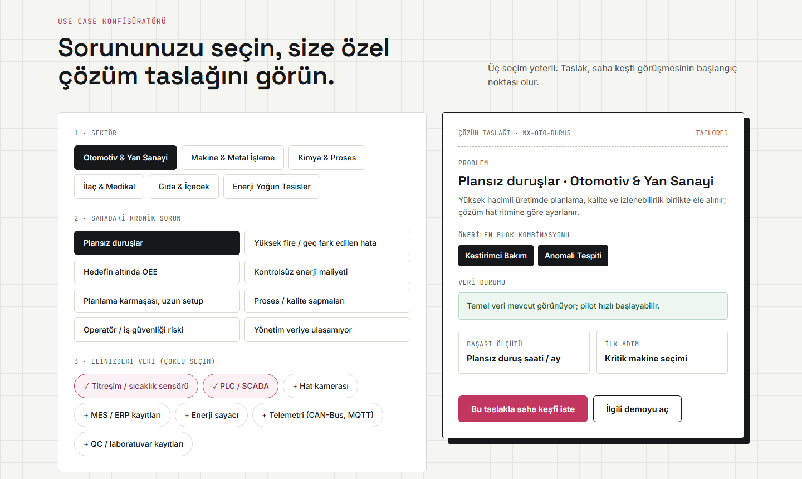
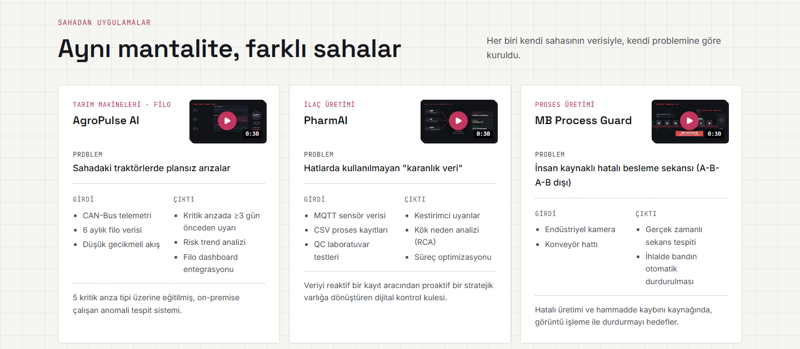

# Industrial AI Nexus

**Tailored industrial AI solutions & applications**

> Fabrikalar parmak izi gibidir. Sorunlar şablonlarla çözülmez.

Industrial AI Nexus bir ürün paketi değil, bir çalışma biçimidir. Her çözüm sahadan toplanan gerçek veriyle, yerinde darboğaz analiziyle ve o use case'e özel kurulan bir model mimarisiyle başlar. Bu platform, yaklaşımın tarayıcıda çalışan bir **sanal PoC**'udur; gerçek projede aynı bloklar tesisinizde, sizin verinizle ve on-premise olarak yeniden kurulur.

[**Platformu inceleyin →**](https://akerdogmus.github.io/industrial-ai-nexus/)

---

## Yaklaşım

| Hazır çözümler | Use-case odaklı AI |
|---|---|
| Standart modül, sahaya uydurulur | Çözüm, sahadaki soruna göre kurulur |
| Genel veriyle eğitilmiş model | Hattınızın verisiyle eğitilen model |
| Başarı: "sistem kuruldu" | Başarı: ilk gün yazılan ölçüt |

### Veriden değere yolculuk

1. **Sahadan veri toplama** — Sensör, PLC, MES ve operatör bilgisi tek bir veri envanterinde toplanır.
2. **Darboğaz analizi** — Veri analiz edilir, darboğazlar etkisine göre önceliklendirilir ve bir çözüm şartnamesine dönüşür.
3. **Özelleştirilmiş AI çözümü** — Use case'e özel uygulama kurulur, mevcut sistemlere entegre edilir ve etkisi ölçülür.

---

## Use Case Konfigüratörü

Ziyaretçi üç seçim yapar: **sektör**, **sahadaki kronik sorun** ve **elindeki veri**. Konfigüratör anında bir çözüm taslağı çıkarır: önerilen blok kombinasyonu, eksik veri ve ölçüm planı, başarı ölçütü ve ilk adım. Taslak, saha keşfi talebi olarak doğrudan ACD'ye iletilir.

---

## Aynı mantalite, farklı sahalar

Her vaka kısa bir tanıtım filmiyle anlatılır. Gizlilik nedeniyle gerçek platform arayüzleri yerine temsili animasyonlar kullanılır.

| Uygulama | Saha | Sorun → Çözüm |
|---|---|---|
| **AgroPulse AI** | Tarım makineleri · filo | Plansız arızalar → CAN-Bus telemetrisi ve arıza tipine özel modellerle günler önceden kestirimci uyarı (on-premise) |
| **PharmAI** | İlaç üretimi | Kullanılmayan "karanlık veri" → proses kayıtları ve QC testlerini birleştiren dijital kontrol kulesi, kök neden analizi |
| **MB Process Guard** | Proses üretimi | Hatalı mikser besleme sekansı → endüstriyel kamera ile gerçek zamanlı sıra denetimi, ihlalde bandın otomatik durması |
| **RKVision Guard** | İş güvenliği | Operatör uzvunun tehlikeli bölgeye girmesi → bilgisayarlı görü ile 7/24 izleme, makinenin anında durması |
| **Synth Vision Suite** | Görüntü verisi | Az sayıda hata görüntüsü → parametrik hata enjeksiyonuyla sentetik veri, gerçek hatta kusur tespiti |

---

## Çözüm blokları

Sahada tekrar tekrar karşılaşılan problem tiplerinden doğan yedi blok. Platformda her biri simüle veriyle canlı olarak denenebilir; gerçek projede aynı blok sizin verinizle yeniden kurulur. Listede olmayan bir sorun, bir sonraki bloğun başlangıcıdır.

| Blok | Kapsam | Ne yapar |
|---|---|---|
| **Kestirimci Bakım** | Varlık | Titreşim, sıcaklık ve devir verisinden arıza riskini ve kalan faydalı ömrü tahmin eder |
| **Üretim Verimliliği** | Hat | Hattın dijital ikizinde darboğazı bulur, OEE'yi izler ve optimizasyon önerir |
| **Enerji Optimizasyonu** | Tesis | Yükü tarifeye göre kaydırır; fatura, karbon ve termin dengesini gösterir |
| **Kalite & Fire (Vision)** | Ürün | Kamera görüntüsünde hataları tespit eder, kabul/fire kararı verir |
| **Üretim Planlama** | Plan | Sipariş havuzunu setup ve termin kısıtlarıyla yeniden çizelgeler |
| **Anomali Tespiti** | Süreç | Sensör sinyallerinde sapma, parazit, sıçrama ve sinyal donmasını yakalar |
| **AI Copilot** | Karar | Fabrika verisini doğal dille sorgulama ve raporlama |

---

## Saha keşfi

Sahanızdaki sorunu birlikte tanımlamak için: **[info@acd.com.tr](mailto:info@acd.com.tr)**

---

## Lisans

© 2026 **ACD | Veri Mühendisliği**. Tüm hakları saklıdır.

Bu depodaki yazılım, kaynak kod, tasarım, metin, görsel, video, marka ve fikirler dahil tüm içerik ve fikri mülkiyet hakları ACD | Veri Mühendisliği'ne aittir. İçerik yalnızca platformun tanıtımı amacıyla görüntülenmek üzere yayınlanmıştır. Önceden yazılı izin alınmadan kopyalanamaz, çoğaltılamaz, değiştirilemez, dağıtılamaz, yayınlanamaz, ticari veya ticari olmayan amaçlarla kullanılamaz ve türev çalışmalarda kullanılamaz. Ayrıntılar için [LICENSE](LICENSE) dosyasına bakın.
