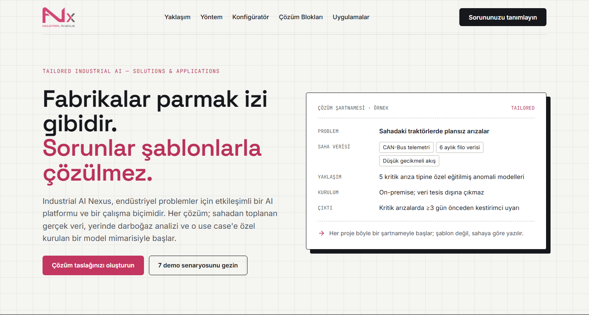
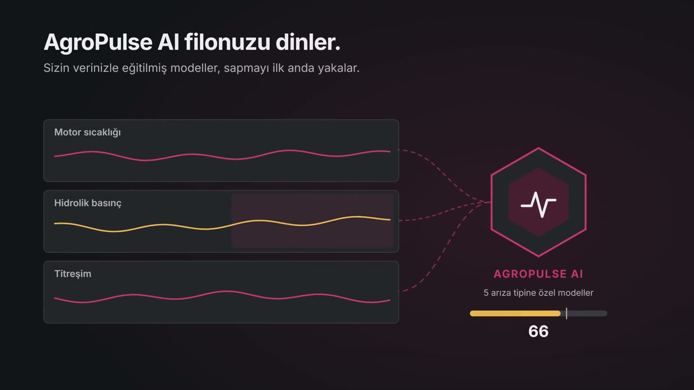

# Industrial AI Nexus



**Tailored industrial AI solutions & applications**

> Fabrikalar parmak izi gibidir. Sorunlar şablonlarla çözülmez.

Industrial AI Nexus, endüstriyel problemler için etkileşimli bir AI platformu ve bir çalışma biçimidir. Hazır bir paket değil: her çözüm sahadan toplanan gerçek veriyle, yerinde darboğaz analiziyle ve o use case'e özel kurulan bir model mimarisiyle başlar. Bu site, o yaklaşımın tarayıcıda çalışan bir **sanal PoC**'udur; gerçek projede aynı bloklar tesisinizde, sizin verinizle ve on-premise olarak yeniden kurulur.

[**Canlı siteyi açın →**](https://akerdogmus.github.io/industrial-ai-nexus/)

---

## Yaklaşım

| Hazır çözümler | Use-case odaklı AI |
|---|---|
| Standart modül, sahaya uydurulur | Çözüm, sahadaki soruna göre kurulur |
| Genel veriyle eğitilmiş model | Hattınızın verisiyle eğitilen model |
| Başarı: "sistem kuruldu" | Başarı: ilk gün yazılan ölçüt |

**Veriden değere yolculuk**

1. **Sahadan veri toplama** — sensör, PLC, MES ve operatör bilgisi tek bir veri envanterinde toplanır.
2. **Darboğaz analizi** — veri analiz edilir, darboğazlar etkisine göre önceliklendirilir ve bir çözüm şartnamesine dönüşür.
3. **Özelleştirilmiş AI çözümü** — use case'e özel uygulama kurulur, mevcut sistemlere entegre edilir ve etkisi ölçülür.

---

## Use Case Konfigüratörü


Ziyaretçi üç seçim yapar: **sektör**, **sahadaki kronik sorun** ve **elindeki veri**. Konfigüratör anında bir çözüm taslağı çıkarır:

- önerilen blok kombinasyonu,
- eksik veri ve keşifte gereken ölçüm planı,
- başarı ölçütü ve ilk adım.

"Bu taslakla saha keşfi iste" butonu taslağı içeren bir e-postayı **info@acd.com.tr** adresine hazırlar. İlgili demo tek tıkla açılır.

---

## Sahadan uygulamalar


Her vaka kartının sağ üstündeki küçük önizlemeye tıklandığında kart, pop-up bir oynatıcıya büyür ve ~30 sn'lik tanıtım filmi oynar. Filmler Claude Motion ile üretildi; gizlilik nedeniyle gerçek platform arayüzleri yerine temsili animasyonlar kullanılır.



| Uygulama | Saha | Sorun → Çözüm |
|---|---|---|
| **AgroPulse AI** | Tarım makineleri · filo | Plansız arızalar → CAN-Bus telemetrisi ve 5 arıza tipine özel modellerle ≥3 gün önceden kestirimci uyarı (on-premise) |
| **PharmAI** | İlaç üretimi | Kullanılmayan "karanlık veri" → MQTT, CSV proses kayıtları ve QC testlerini birleştiren dijital kontrol kulesi, kök neden analizi |
| **MB Process Guard** | Proses üretimi | Hatalı mikser besleme sekansı → endüstriyel kamera ile gerçek zamanlı sıra denetimi, ihlalde bandın otomatik durması |
| **RKVision Guard** | İş güvenliği | Operatör uzvunun tehlikeli bölgeye girmesi → bilgisayarlı görü ile 7/24 izleme, uyarı bölgesinde makinenin anında durması |
| **Synth Vision Suite** | Görüntü verisi | Az sayıda hata görüntüsü → parametrik hata enjeksiyonu ve senaryoya özel modellerle sentetik veri, gerçek hatta kusur tespiti |

---

## Çözüm blokları (canlı demolar)

Sahada tekrar tekrar karşılaşılan problem tiplerinden doğan yedi blok. Her biri tarayıcıda simüle veriyle çalışır; gerçek projede aynı blok sizin verinizle yeniden kurulur. Listede olmayan bir sorun, bir sonraki bloğun başlangıcıdır.

| Blok | Kapsam | Ne yapar |
|---|---|---|
| **Kestirimci Bakım** | Varlık | CNC titreşim, sıcaklık ve devir verisinden arıza riskini ve kalan faydalı ömrü tahmin eder (LSTM-Autoencoder simülasyonu, 3D makine görünümü) |
| **Üretim Verimliliği** | Hat | Hattın dijital ikizinde darboğazı bulur, OEE'yi (Kullanılabilirlik × Performans × Kalite) izler ve optimizasyon önerir |
| **Enerji Optimizasyonu** | Tesis | Isıl işlem fırınının yükünü tarifeye göre kaydırır; fatura, karbon ve termin dengesini gösterir |
| **Kalite & Fire (Vision)** | Ürün | Kamera görüntüsünde hataları tespit eder, güven eşiğine göre kabul/fire kararı verir |
| **Üretim Planlama** | Plan | Sipariş havuzunu setup ve termin kısıtlarıyla Gantt üzerinde yeniden çizelgeler, önce/sonra KPI'larını karşılaştırır |
| **Anomali Tespiti** | Süreç | Basınç, sıcaklık ve titreşim sinyallerinde Z-Score tabanlı sapma tespiti; parazit, spike ve sensör donması senaryoları |
| **AI Copilot** | Karar | Fabrika verisini doğal dille sorgulama ve raporlama (RAG simülasyonu) |

---

## Saha keşfi

Saha keşfi talepleri **[info@acd.com.tr](mailto:info@acd.com.tr)** adresine gelir. Sitedeki "Saha keşfi planlayın" butonu firma, saha/hat, kronik sorun ve mevcut veriyi soran bir e-posta taslağı açar.

---

## Kurulum ve geliştirme

### Canlı kullanım
Kurulum gerekmez: **[akerdogmus.github.io/industrial-ai-nexus](https://akerdogmus.github.io/industrial-ai-nexus/)**

### Yerel geliştirme

```bash
git clone https://github.com/Akerdogmus/industrial-ai-nexus.git
cd industrial-ai-nexus/frontend
npm install
npm run dev
```

Windows'ta ana dizindeki `start_demo.bat` da kullanılabilir. `main` dalına yapılan her push, GitHub Actions ile GitHub Pages'e yayınlanır.

### Tanıtım filmlerini güncellemek

Filmler Claude Motion'da düzenlenir ve **Export → MP4** ile indirilir. Ardından site sürümleri tek komutla üretilir (görüntü web için sıkıştırılır, Motion müziği korunur):

```bash
pip install imageio-ffmpeg
python frontend/scripts/mux-promos.py "C:/Users/<kullanıcı>/Downloads"
```

Çıktılar `frontend/public/assets/videos/promo/<vaka>.mp4` olarak yazılır. Hangi dosyanın hangi vakaya ait olduğu betiğin içindeki `FILMS` tablosundadır.

### Proje yapısı

```
frontend/
├── src/
│   ├── landing/            # v3 landing: Landing, Configurator, içerik (content.ts), stiller
│   │   └── videos/         # vaka önizlemeleri, pop-up oynatıcı, animasyon yedekleri
│   ├── components/         # 7 canlı demo modülü
│   ├── engines/            # simülasyon motorları (saf TypeScript)
│   └── index.css           # demo teması (Nx magenta + amber, grafit zemin)
├── public/assets/
│   ├── images/             # Nx logo, demo görselleri
│   └── videos/promo/       # tanıtım filmleri (web sürümleri)
└── scripts/mux-promos.py   # Motion dışa aktarımlarını site için hazırlar
```

Metinlerin büyük kısmı (sektörler, sorunlar, bloklar, vakalar, iletişim adresi) `frontend/src/landing/content.ts` dosyasından yönetilir.

---

## Teknoloji

- **Frontend:** React 19, TypeScript, Vite
- **Görselleştirme:** Recharts, Framer Motion, Three.js (React Three Fiber), Lucide
- **Stil:** CSS değişkenleri; Space Grotesk, Inter, JetBrains Mono
- **Simülasyon:** Saf TypeScript motorlar, tamamen istemci tarafında
- **Tanıtım filmleri:** Claude Motion; web sürümleri ffmpeg ile

---

## Lisans

Bu proje [MIT Lisansı](LICENSE) ile lisanslanmıştır.

---

* Sürüm: 3.0.0
* Tarih: 2026-11-18
* Geliştiren: A. Kerem Erdogmus
* İletişim: kereme@acd.com.tr · Saha keşfi: info@acd.com.tr

## Sürüm Notları (v3.0.0)
### Tailored, not packaged

#### Yeni landing ve anlatı
- **"Blueprint" tasarımı:** Nx logosu, magenta/grafit marka renkleri, açık mühendislik estetiği.
- **Yeni anlatı:** "Fabrikalar parmak izi gibidir"; hazır çözümler ile use-case odaklı AI karşılaştırması; veriden değere yolculuk; sanal PoC ile on-premise farkı.
- **Çözüm blokları:** 7 demo modülü birleştirilebilir bloklar olarak yeniden konumlandı, "Yeni bir blok" kartı eklendi.
- **Kaldırılanlar:** Simüle ROI ticker'ı, doğrulanmamış hero istatistikleri, parçacık ve imleç efektleri.

#### Use Case Konfigüratörü — Yeni
- Sektör, kronik sorun ve mevcut veriye göre anlık çözüm taslağı.
- Taslak, saha keşfi talebi olarak info@acd.com.tr adresine gönderilir.

#### Sahadan uygulamalar ve tanıtım filmleri — Yeni
- AgroPulse AI, PharmAI, MB Process Guard, RKVision Guard ve Synth Vision Suite vaka kartları.
- Kartın sağ üstündeki önizleme, tıklanınca büyüyerek pop-up oynatıcıya dönüşür.
- Claude Motion ile üretilmiş ~30 sn'lik tanıtım filmleri (özgün müzik, Nx + ACD kapanış kartı).

#### Canlı demolar
- **Tema:** Nx magenta + amber, grafit zemin, Space Grotesk başlıklar, emoji yerine çizgi ikonlar.
- **Düzeltmeler:**
  - Kestirimci Bakım ve Enerji grafiklerinin boş görünmesi giderildi.
  - "0ms" çıkarım süresi yerine gerçekçi gecikme gösteriliyor.
  - Üretim Planlama'da makine etiketi çakışması ve kesilen saat satırları düzeltildi.
  - Anomali Tespiti'nde negatif basınç, yanlış eşik bantları, aynı renkteki küme noktaları ve eksik analiz metni düzeltildi.
  - index.css içindeki bozuk satırlar kaldırıldı.

---

## Sürüm Notları (v2.1.0)
### Platform Tanıtım Bölümü

#### "Industrial AI Nexus Nedir?" Kartı
- **Platform Tanıtımı:** Ana sayfaya platform açıklama kartı eklendi.
- **3 Aşamalı Süreç Gösterimi:** Veri Toplama → Saha Analizi → AI Çözüm akışı görselleştirildi.
- **7 Aktif Çözüm Alanı:** Mevcut modüller domain badge listesiyle tanıtıldı.
- **Genişletilebilirlik Notu:** Farklı endüstriyel sorunlar için yeni çözümler geliştirilebileceğine dair ipucu eklendi.

---

## Sürüm Notları (v2.0.0)
### Büyük Güncelleme — Modül Yeniden Tasarımı

#### Kalite Kontrol (Computer Vision) — Tam Yenileme
- **Oturum İstatistik Çubuğu:** Taranan/kabul edilen/fire parça sayısı ve geçiş oranı her taramada canlı güncellenir.
- **Eşik Presetleri:** "Hassas / Dengeli / Kesin" modları tek tıkla anomali eşiğini ayarlar.
- **Şiddet Göstergesi (Severity Gauge):** Tespit edilen anomalilerin ağırlıklı şiddet skorunu renkli bar ile gösterir.
- **Güven Çubukları:** Her tespit kalemi için ayrı `confidence` yüzdesi görseli.
- **Çıkarım Süresi:** YOLOv8-nano GPU çıkarım süresini gerçekçi ms değerleriyle (28–72ms) gösterir.
- **Tarama Kapısı (Scan Gate):** İstatistikler ve tespit kutucukları yalnızca lazer taraması tamamlandıktan sonra görünür.
- **2 Yeni Örnek Parça:** Minör ve kritik hata senaryoları için ek demo parçaları eklendi.

#### Üretim Planlama — Tam Yenileme
- **AI Akıl Yürütme Animasyonu:** "AI ile Çizelgele" butonuna basıldığında 5 adımlı staggered reasoning panel açılır.
- **Önce/Sonra KPI Sayaçları:** Optimizasyon öncesi ve sonrası OTD, Makespan, Doluluk değerleri animasyonlu sayaçlarla karşılaştırılır.
- **Optimizasyon Özet Kartı:** Tüm iyileştirmeleri özet hâlinde gösteren slide-in kart.
- **Termin İşaretçileri:** Gantt çizelgesinde her sipariş için kırmızı/yeşil termin üçgenleri.
- **Makine Doluluk Çubukları:** Her makine satırında yüzdelik kullanım bar göstergesi.
- **Boşluk Blokları:** Makineler arası plansız duruş sürelerini taralı blok olarak görselleştirir.
- **"ŞİMDİ" Çizgisi:** Güncel saati Gantt üzerinde animasyonlu pulse ile işaretler.
- **Sipariş Çizelgesi Tablosu:** Gantt altında 8 sütunlu sipariş detay tablosu.
- **Sipariş Havuzu:** Sol sidebar'dan çizelge altına taşındı; yatay chip listesi olarak gösterilir.
- **Layout Optimizasyonu:** 280px sabit sidebar | 1fr Gantt iki sütun grid düzeni; scroll yok.

#### Anomali Tespiti — Tam Yenileme
- **Çok-Sensör Desteği:** Basınç (MPa), Sıcaklık (°C) ve Titreşim (mm/s) sensörleri arasında anlık geçiş; her sensörün kendine özel sinyal karakteri, rengi ve eşiği vardır.
- **Anomali Zaman Şeridi:** Grafik altında 60 saniyelik ısı haritası bant; yeşil/sarı/kırmızı segmentler geçmiş anomali yoğunluğunu gösterir.
- **AI Akıl Yürütme Animasyonu:** Anomali tespitinde sensör + bozucu türüne özel 3 adımlı staggered reasoning panel.
- **Güven Göstergesi:** Header'da anlık güven skoru widget'ı (yeşil → sarı → kırmızı geçiş).
- **Canlı Küme Animasyonu:** Recharts scatter yerine özel SVG + Framer Motion; anomali noktaları merkezdeyken dışarı fade-in ederek fırlar.
- **Yapılandırılmış Olay Listesi:** Terminal log yerine kart tabanlı anomali kayıt listesi; zaman, sensör, Düşük/Orta/Kritik şiddet etiketi ve skor çubuğu içerir.

---

## Sürüm Notları (v1.1.1)
### Güvenlik Güncellemesi (Hotfix)
- **XSS Koruması:** AI Chatbot modülünde kullanıcı girişleri için `escapeHtml` sanitization katmanı eklendi.
- **Güvenlik İyileştirmesi:** "Input Injection" engellendi.
- **UI Fixes:** Changelog ikonları ve Kalite Kontrol modülü görsel yolları düzeltildi.

## Sürüm Notları (v1.1.0)
### Modül 1: Kestirimci Bakım (Predictive Maintenance) Güncellemeleri
- **Gelişmiş Grafikler:** Titreşim analizine ek olarak **Sıcaklık (Temperature)** ve **RPM (Devir)** grafikleri eklendi.
- **Premium 3D Model:** Makine görselleştirmesi endüstriyel standartlarda, yüksek detaylı yeni bir 3D model ile değiştirildi.
- **Single-Screen Layout:** Tüm analiz verileri ve kontrollerin tek ekranda görülebilmesi için layout optimize edildi.
- **UX İyileştirmeleri:** AI analiz sonuçları öne çıkarıldı, başlangıç parametreleri optimize edildi.
